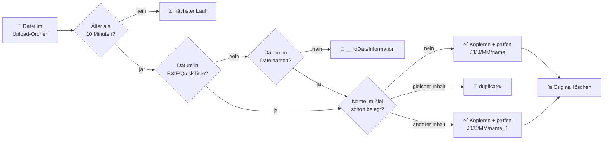

<div align="center">

# 📸 synPhotoMove

**Schluss mit dem Upload-Chaos auf der Synology.**
Fotos und Videos aus den Upload-Ordnern der ganzen Familie landen automatisch und sicher
in `Jahr/Monat` – sortiert nach dem echten Aufnahmedatum.

[](https://www.python.org/)
[](https://www.synology.com/)
[](https://exiftool.org/)
[](LICENSE)

</div>

---

## Das Problem

Jeder in der Familie lädt Fotos hoch – per Synology Photos App, PhotoSync, Resilio oder per Hand.
Am Ende liegen tausende Dateien in `upload_alice/DCIM/Camera/…`, `upload_bob/WhatsApp/…`,
mit Namen wie `IMG_4711.HEIC`, `PXL_20260829_191418576.jpg` oder `FB_IMG_1707866479342.jpg`.

## Die Lösung

synPhotoMove läuft alle 30 Minuten im Aufgabenplaner und räumt auf:

```
photo/                                    photo/
├── upload_alice/                         ├── upload_alice/
│   └── DCIM/Camera/                      │   ├── __noDateInformation/
│       ├── IMG_4711.HEIC                 │   │   └── Postkarte.png
│       ├── IMG_4711.MOV          ──▶     │   ├── duplicate/
│       ├── IMG_4711.AAE                  │   │   └── IMG_0815.jpg
│       ├── IMG_0815.jpg  (schon da)      │   └── logs/
│       └── Postkarte.png                 │       └── synphotomove_2026-11.log
└── upload_bob/                           ├── 2024/
    └── WhatsApp/                         │   └── 05/
        └── IMG-20240526-WA0027.jpg       │       └── IMG-20240526-WA0027.jpg
                                          └── 2026/
                                              └── 10/
                                                  ├── IMG_4711.HEIC
                                                  ├── IMG_4711.MOV
                                                  └── IMG_4711.AAE
```

## ✨ Features

| | |
|---|---|
| 🗓️ **Echtes Aufnahmedatum** | EXIF/QuickTime über exiftool – Videozeiten in UTC werden korrekt in Ortszeit umgerechnet |
| 🔎 **Datum aus dem Dateinamen** | Fallback für WhatsApp, Signal, Screenshots, Pixel, Facebook (Unix-Zeitstempel) und mehr |
| 🛡️ **Kein Datenverlust** | Kopie in eine Temp-Datei, Prüfung per Größe + SHA-256, erst dann wird das Original gelöscht |
| 👯 **Duplikat-Erkennung** | Inhaltsgleiche Dateien wandern nach `duplicate/` statt doppelt in die Ablage |
| 🔢 **Saubere Umbenennung** | Name belegt, Inhalt anders → `IMG_1_1.jpg`, `IMG_1_2.jpg` … (Groß-/Kleinschreibung wie unter SMB) |
| 🍏 **Live Photos bleiben zusammen** | `HEIC` + `MOV` bekommen bei Konflikten dieselbe Nummer – Synology Photos zeigt sie weiter als Live Photo |
| 📎 **Begleitdateien wandern mit** | `.AAE`, `.xmp`, `.thm` folgen ihrem Foto, auch unter neuem Namen |
| ⏳ **Upload-Schutz** | Dateien, die gerade erst geschrieben wurden, sind beim nächsten Lauf dran |
| 🔒 **Nur ein Lauf gleichzeitig** | Dauert ein Lauf länger als 30 Minuten, beendet sich der nächste einfach |
| 🧪 **Testmodus** | `--dry-run` zeigt, was passieren würde – ohne eine Datei anzufassen |
| 📝 **Log pro Nutzer** | Jeder sieht in seinem `logs/`-Ordner, wo seine Fotos gelandet sind |
| 📦 **Keine Installation** | Eine Python-Datei, nur Standardbibliothek, läuft mit dem Python von DSM 7 |

## So funktioniert's



<details>
<summary><b>Welche Datumsquellen werden geprüft?</b></summary>

1. **Metadaten** in dieser Reihenfolge: `DateTimeOriginal`, `CreationDate`, `CreateDate`,
   `MediaCreateDate`, `TrackCreateDate`, `DateCreated`, `DateTimeCreated`
2. **Dateiname**, zum Beispiel:

   | Dateiname | erkanntes Datum |
   |---|---|
   | `20240501_191127.jpg` | 01.05.2024 19:11:27 |
   | `IMG-20240526-WA0027.jpg` | 26.05.2024 |
   | `PXL_20240315_123456789.jpg` | 15.03.2024 12:34:56 |
   | `WhatsApp Image 2024-03-15 at 12.34.56.jpeg` | 15.03.2024 12:34:56 |
   | `Screenshot_2024-03-15-12-34-56-123_com.app.png` | 15.03.2024 12:34:56 |
   | `signal-2023-12-24-180000.jpg` | 24.12.2023 18:00:00 |
   | `Urlaub 24.12.2023.jpg` | 24.12.2023 |
   | `FB_IMG_1707866479342.jpg` | Unix-Zeitstempel in ms |

Unplausible Daten (vor 1990 im Dateinamen, in der Zukunft, `0000:00:00`) werden ignoriert.

</details>

## 🚀 Schnellstart

### Voraussetzungen

- Synology mit **DSM 7** (bringt Python 3.8+ mit)
- **exiftool** (siehe unten)
- SSH-Zugang (*Systemsteuerung → Terminal & SNMP → SSH-Dienst aktivieren*)

#### Ist exiftool schon installiert?

Per SSH auf der NAS anmelden und prüfen:

```bash
which exiftool && exiftool -ver
```

| Ausgabe | Bedeutung |
|---|---|
| `/usr/local/bin/exiftool` und eine Versionsnummer, z.B. `13.24` | ✅ Alles da. Den angezeigten Pfad später bei `exiftool =` in der INI-Datei eintragen. |
| keine Ausgabe | ❌ Nicht installiert (oder nicht im Suchpfad) – weiter mit der Installation. |

#### exiftool installieren

exiftool ist ein Perl-Programm und braucht keine Installation im eigentlichen Sinn: entpacken, fertig.

**1. Perl prüfen.** Erscheint bei `perl -v` keine Versionsnummer, im *Paket-Zentrum* das Paket
**Perl** installieren.

**2. Aktuelle Version herunterladen und entpacken** (Zielordner nach Belieben anpassen):

```bash
cd /volume1/scripts
VER=$(curl -s https://exiftool.org/ver.txt)
curl -L -o exiftool.tar.gz "https://sourceforge.net/projects/exiftool/files/Image-ExifTool-$VER.tar.gz/download"
mkdir exiftool && tar -xzf exiftool.tar.gz -C exiftool --strip-components=1
rm exiftool.tar.gz
```

**3. Testen:**

```bash
/volume1/scripts/exiftool/exiftool -ver
```

Erscheint die Versionsnummer, in `synphotomove.ini` eintragen:

```ini
exiftool = /volume1/scripts/exiftool/exiftool
```

> ⚠️ Nur das Paket `Image-ExifTool-….tar.gz` verwenden – die `.zip`-Dateien sind für Windows.
> Zum Aktualisieren später einfach den Ordner `exiftool` löschen und Schritt 2 wiederholen.

Fehlt exiftool oder stimmt der Pfad nicht, bricht synPhotoMove sofort mit
`exiftool nicht gefunden: …` und Exit-Code 2 ab – es wird also nichts angefasst.

### 1. Herunterladen

`synphotomove.py` und `synphotomove.ini.example` in einen Ordner auf der NAS kopieren,
z.B. `/volume1/scripts/synphotomove/`. Oder per SSH:

```bash
git clone https://github.com/madcoda9000/synPhotoMove.git /volume1/scripts/synphotomove
```

### 2. Konfigurieren

```bash
cd /volume1/scripts/synphotomove
cp synphotomove.ini.example synphotomove.ini
```

Das Wichtigste in `synphotomove.ini`:

```ini
[general]
target = /volume1/photo          ; hier entstehen JJJJ/MM

[sources]
alice = /volume1/photo/upload_alice
bob   = /volume1/photo/upload_bob
```

> 💡 Den Volume-Pfad einer Freigabe zeigt *Systemsteuerung → Gemeinsamer Ordner*.

### 3. Testlauf

```bash
sudo python3 synphotomove.py -c synphotomove.ini --dry-run
```

Es wird nur angezeigt, was passieren würde:

```
2026-11-03 14:00:01 INFO    TESTMODUS – es werden keine Dateien verändert.
2026-11-03 14:00:04 INFO    [TEST] EINSORTIERT DCIM/Camera/PXL_20261025_080635905.jpg -> 2026/10/PXL_20261025_080635905.jpg (DateTimeOriginal: 2026-10-25 09:06:35)
2026-11-03 14:00:04 INFO    [TEST] UMBENANNT   DCIM/Camera/IMG_4711.HEIC -> 2026/10/IMG_4711_1.HEIC (DateTimeOriginal: 2026-10-12 18:30:02)
2026-11-03 14:00:04 INFO    [TEST]   Begleitdatei DCIM/Camera/IMG_4711.AAE -> 2026/10/IMG_4711_1.AAE
2026-11-03 14:00:04 INFO    [TEST] DUPLIKAT    DCIM/Camera/IMG_0815.jpg -> duplicate/IMG_0815.jpg (identisch mit 2025/07/IMG_0815.jpg)
2026-11-03 14:00:04 INFO    [TEST] OHNE DATUM  Postkarte.png -> __noDateInformation/Postkarte.png
2026-11-03 14:00:04 INFO    alice: 2 einsortiert (davon 1 umbenannt), 1 ohne Datum, 1 Duplikate, 1 Begleitdateien, 0 noch zu jung, 0 Fehler
2026-11-03 14:00:04 INFO    Fertig: 2 einsortiert (davon 1 umbenannt), 1 ohne Datum, 1 Duplikate, 1 Begleitdateien, 0 noch zu jung, 0 Fehler
```

### 4. Automatisieren

*Systemsteuerung → Aufgabenplaner → Erstellen → Geplante Aufgabe → Benutzerdefiniertes Skript*

| Reiter | Einstellung |
|---|---|
| Allgemein | Benutzer: `root` |
| Zeitplan | Täglich, alle 30 Minuten |
| Aufgabeneinstellungen | `python3 /volume1/scripts/synphotomove/synphotomove.py -c /volume1/scripts/synphotomove/synphotomove.ini` |
| Benachrichtigung | ☑ Ausführungsdetails per E-Mail senden, ☑ nur bei abnormaler Beendigung |

Fertig. Eine E-Mail kommt nur, wenn wirklich etwas schiefgeht.

## ⚙️ Konfiguration

Alle Optionen im Abschnitt `[general]` – kommentiert in
[`synphotomove.ini.example`](synphotomove.ini.example):

| Option | Standard | Bedeutung |
|---|---|---|
| `target` | – | Fotoablage, darin entstehen die Datumsordner |
| `folder_format` | `{year}/{month}` | Ordnerstruktur, Platzhalter `{year}`, `{month}`, `{day}` |
| `exiftool` | `/usr/local/bin/exiftool` | Pfad zu exiftool |
| `min_age_minutes` | `10` | jüngere Dateien beim nächsten Lauf verarbeiten |
| `include_videos` | `true` | Videos mit einsortieren |
| `nodate_folder` | `__noDateInformation` | Ordner für Dateien ohne Datum (im Upload-Ordner) |
| `duplicate_folder` | `duplicate` | Ordner für Duplikate (im Upload-Ordner) |
| `log_folder` | `logs` | Ordner für die Logdateien (im Upload-Ordner) |
| `log_keep_months` | `12` | so lange werden Logs aufbewahrt |
| `exclude_dirs` | `error` | weitere Ordner, die nicht durchsucht werden |
| `remove_empty_dirs` | `false` | leere Unterordner nach dem Lauf löschen |
| `sidecar_extensions` | `aae xmp thm` | Begleitdateien, die mitwandern |
| `image_extensions` / `video_extensions` | viele | eigene Listen der Dateiendungen |

`@eaDir`, `#recycle`, `#snapshot` und versteckte Ordner werden nie durchsucht.

## 🖥️ Kommandozeile

```
synphotomove.py -c synphotomove.ini [--dry-run] [--only NAME] [--min-age MIN]
                [--remove-empty-dirs] [--target DIR] [--source DIR] [-v]
```

| Option | Bedeutung |
|---|---|
| `-c`, `--config` | Konfigurationsdatei |
| `-n`, `--dry-run` | Testmodus: nur anzeigen, nichts verändern |
| `--only NAME` | nur diese Quelle aus `[sources]` (mehrfach möglich) |
| `--min-age MIN` | Mindestalter der Dateien in Minuten |
| `--remove-empty-dirs` | leere Unterordner in den Upload-Ordnern löschen |
| `--target` / `--source` | Ziel bzw. zusätzliche Quelle ohne INI-Datei |
| `-v`, `--verbose` | ausführliche Ausgabe |

**Exit-Codes:** `0` alles gut · `1` Fehler bei einzelnen Dateien · `2` Konfigurationsfehler

## 🛡️ Sicherheit

synPhotoMove fasst Originale nur an, wenn die Kopie nachweislich vollständig ist:

1. Kopie in eine versteckte Temp-Datei `.name.synphotomove-tmp`, mit `fsync`
2. Größe und SHA-256 der Kopie prüfen
3. Atomar auf den endgültigen Namen umbenennen und prüfen, dass die Datei da ist
4. Erst dann: Original (und seine `@eaDir`-Vorschaubilder) löschen

Wird ein Lauf abgebrochen (Strg+C, Neustart, Stromausfall), bleibt im schlimmsten Fall eine
Temp-Datei übrig, die beim nächsten Lauf aufgeräumt wird. Bei jedem Fehler bleibt die Datei
einfach liegen und wird beim nächsten Lauf erneut versucht.

## ❓ FAQ

<details>
<summary><b>Warum liegt eine Datei in <code>__noDateInformation</code>?</b></summary>

Weder Metadaten noch Dateiname enthalten ein Datum – typisch für Screenshots aus Apps,
weitergeleitete Bilder oder KI-generierte Bilder. Die Dateien bleiben dort, bis du sie
selbst einsortierst.
</details>

<details>
<summary><b>Die Uhrzeit im Log weicht vom Dateinamen ab!</b></summary>

Manche Kameras (z.B. Google Pixel) schreiben **UTC** in den Dateinamen. synPhotoMove nimmt die
Ortszeit aus den Metadaten – so landet ein Foto von 23:30 am 31. auch im richtigen Monat.
</details>

<details>
<summary><b>Was passiert, wenn gerade noch hochgeladen wird?</b></summary>

Dateien, deren Änderungs- oder Statuszeit jünger als `min_age_minutes` ist, werden übersprungen
und im Log als „noch zu jung“ gezählt. Der nächste Lauf holt sie ab.
</details>

<details>
<summary><b>Läuft das auch ohne Synology?</b></summary>

Ja – auf jedem Linux mit Python 3.8+ und exiftool. Nur die `@eaDir`-Behandlung ist
Synology-spezifisch und schadet anderswo nicht.
</details>

## 🧪 Entwicklung

```bash
python3 -m unittest discover -s tests -v
```

Die Tests nutzen ein Ersatz-exiftool (`tests/fake_exiftool.py`) und brauchen kein echtes exiftool.
Der Code muss Python-3.8-kompatibel bleiben (DSM 7).

## 📄 Lizenz

[MIT](LICENSE) © 2026 Sascha Heimann
